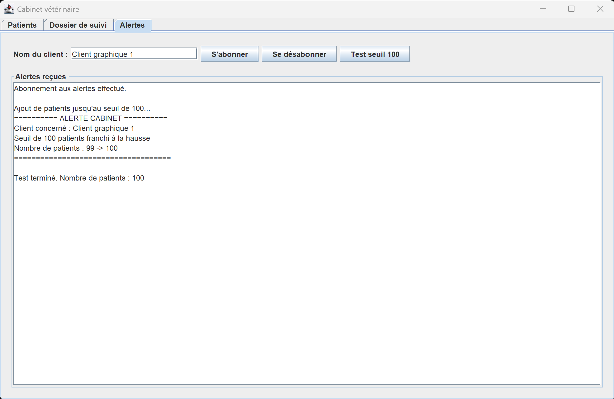

# Cabinet vétérinaire distribué avec Java RMI

**HAI704I — Architectures logicielles distribuées — TP1 — 2026–2027**

**Étudiant : Omar RHANBOURI**

Dépôt GitHub : [SJOLK/RHANBOURI_Omar_HAI704I_TP1](https://github.com/SJOLK/RHANBOURI_Omar_HAI704I_TP1)

## Présentation

Cette application permet à plusieurs vétérinaires d’utiliser à distance un même cabinet vétérinaire.

Elle repose sur Java RMI et propose deux interfaces clientes :

- une interface console ;
- une interface graphique développée avec Swing dans le cadre de la partie C bonus.

Les données sont conservées en mémoire par le serveur. Elles sont donc réinitialisées lorsque celui-ci redémarre.

## Fonctionnalités

L’application permet de :

- afficher la liste des patients ;
- rechercher un patient par son nom ;
- enregistrer un nouveau patient ;
- consulter son dossier de suivi ;
- modifier son état de santé ;
- ajouter une observation dans son historique ;
- s’abonner aux alertes du cabinet ;
- se désabonner des alertes ;
- notifier les clients lorsque le nombre de patients franchit les seuils 100, 500 ou 1000 ;
- utiliser plusieurs clients simultanément.

## Architecture du projet

Le code source est organisé dans trois modules placés dans le dossier `source/` :

```text
source/
├── common/
│   └── src/
│       └── animal/common/
│           ├── Espece.java
│           ├── IAnimal.java
│           ├── ICabinetVeterinaire.java
│           ├── IDossierSuivi.java
│           └── IObservateurCabinet.java
│
├── server/
│   └── src/
│       └── animal/server/
│           ├── AnimalImpl.java
│           ├── CabinetVeterinaireImpl.java
│           ├── DossierSuiviImpl.java
│           └── Server.java
│
└── client/
    └── src/
        └── animal/client/
            ├── Client.java
            ├── ClientGraphique.java
            ├── ErreurClientException.java
            ├── InterfaceConsole.java
            ├── InterfaceGraphique.java
            ├── LogiqueClient.java
            └── ObservateurCabinetImpl.java
```

Le module `client` dépend uniquement du module `common`. Il ne connaît aucune classe d’implémentation du serveur.

## Rôle des modules

### Module `common`

Ce module contient :

- les interfaces distantes partagées entre le client et le serveur ;
- les classes transmises par valeur ;
- les contrats nécessaires à la communication RMI.

Il doit être présent dans le classpath du client et du serveur.

### Module `server`

Ce module contient :

- les implémentations des objets distants ;
- les patients conservés en mémoire ;
- les dossiers de suivi ;
- la gestion des observateurs ;
- la détection des franchissements de seuil ;
- la création du registre RMI ;
- la publication du cabinet.

### Module `client`

Ce module contient :

- la connexion au registre RMI ;
- la logique cliente commune ;
- l’interface console ;
- l’interface graphique Swing ;
- l’implémentation du callback utilisé pour recevoir les alertes.

## Organisation du client

```text
Client.java
    Connexion au registre RMI et lancement de l’interface console.

ClientGraphique.java
    Connexion au registre RMI et lancement de l’interface Swing.

LogiqueClient.java
    Appels aux interfaces distantes, validation des données et gestion
    des erreurs de communication.

InterfaceConsole.java
    Menu, saisies et affichage dans le terminal.

InterfaceGraphique.java
    Fenêtre Swing et exécution asynchrone des appels distants.

ObservateurCabinetImpl.java
    Réception des callbacks envoyés par le serveur.

ErreurClientException.java
    Représentation des erreurs compréhensibles par les interfaces clientes.
```

`InterfaceConsole` et `InterfaceGraphique` réutilisent toutes les deux `LogiqueClient`. Les appels RMI ne sont donc pas dupliqués dans les interfaces.

## Prérequis

- JDK 17 minimum ;
- JDK 21 recommandé ;
- aucun `module-info.java` ;
- aucune dépendance externe ;
- port RMI utilisé par défaut : `1099`.

## Compilation en ligne de commande

Les commandes suivantes doivent être exécutées depuis la racine du dépôt.

### Windows PowerShell

Créer les dossiers de compilation :

```powershell
New-Item -ItemType Directory -Force source\common\out | Out-Null
New-Item -ItemType Directory -Force source\server\out | Out-Null
New-Item -ItemType Directory -Force source\client\out | Out-Null
```

Compiler le module commun :

```powershell
javac -d source\common\out (Get-ChildItem -Recurse -Filter *.java source\common\src).FullName
```

Compiler le serveur :

```powershell
javac -cp source\common\out -d source\server\out (Get-ChildItem -Recurse -Filter *.java source\server\src).FullName
```

Compiler le client :

```powershell
javac -cp source\common\out -d source\client\out (Get-ChildItem -Recurse -Filter *.java source\client\src).FullName
```

### Linux ou macOS

Créer les dossiers de compilation :

```bash
mkdir -p source/common/out
mkdir -p source/server/out
mkdir -p source/client/out
```

Compiler le module commun :

```bash
javac -d source/common/out $(find source/common/src -name "*.java")
```

Compiler le serveur :

```bash
javac -cp source/common/out \
  -d source/server/out \
  $(find source/server/src -name "*.java")
```

Compiler le client :

```bash
javac -cp source/common/out \
  -d source/client/out \
  $(find source/client/src -name "*.java")
```

## Exécution en ligne de commande

Le serveur crée lui-même le registre RMI. Il n’est donc pas nécessaire de lancer `rmiregistry` séparément.

### Windows PowerShell

Lancer d’abord le serveur :

```powershell
java -cp "source\common\out;source\server\out" animal.server.Server
```

Dans un autre terminal, lancer le client console :

```powershell
java -cp "source\common\out;source\client\out" animal.client.Client
```

Pour lancer le client graphique :

```powershell
java -cp "source\common\out;source\client\out" animal.client.ClientGraphique
```

L’hôte et le port peuvent être précisés :

```powershell
java -cp "source\common\out;source\client\out" animal.client.Client localhost 1099
```

```powershell
java -cp "source\common\out;source\client\out" animal.client.ClientGraphique localhost 1099
```

### Linux ou macOS

Lancer le serveur :

```bash
java -cp "source/common/out:source/server/out" animal.server.Server
```

Lancer le client console :

```bash
java -cp "source/common/out:source/client/out" animal.client.Client
```

Lancer le client graphique :

```bash
java -cp "source/common/out:source/client/out" animal.client.ClientGraphique
```

Avec un hôte et un port personnalisés :

```bash
java -cp "source/common/out:source/client/out" animal.client.Client localhost 1099
```

```bash
java -cp "source/common/out:source/client/out" animal.client.ClientGraphique localhost 1099
```

## Exécution dans IntelliJ IDEA

1. Ouvrir le projet dans IntelliJ IDEA.
2. Vérifier que les modules `server` et `client` dépendent du module `common`.
3. Lancer `animal.server.Server`.
4. Lancer ensuite :
    - `animal.client.Client` pour l’interface console ;
    - ou `animal.client.ClientGraphique` pour l’interface Swing.
5. Pour lancer plusieurs clients, activer **Allow multiple instances** dans la configuration d’exécution.
6. Les arguments sont facultatifs et suivent le format :

```text
hôte port
```

Exemple :

```text
localhost 1099
```

Si aucun argument n’est fourni, le client utilise automatiquement :

```text
localhost:1099
```

## Interface console

Le client console propose le menu suivant :

```text
1. Afficher les patients
2. Rechercher un patient
3. Enregistrer un patient
4. Consulter un dossier de suivi
5. Modifier un dossier de suivi
6. S'abonner aux alertes
7. Se désabonner des alertes
0. Quitter
```

Les saisies incorrectes et les erreurs de communication sont affichées avec un message compréhensible sans interrompre brutalement le client.

## Interface graphique Swing — partie C bonus

L’interface graphique est organisée en trois onglets.

### Onglet Patients

Il permet de :

- charger la liste des patients ;
- rechercher un patient ;
- ajouter un patient ;
- afficher son nom, son maître, sa race et son espèce.

### Onglet Dossier de suivi

Il permet de :

- rechercher le dossier d’un patient ;
- afficher son état de santé ;
- consulter son historique ;
- modifier son état ;
- ajouter une observation.

### Onglet Alertes

Il permet de :

- saisir le nom du client ;
- s’abonner aux callbacks ;
- se désabonner ;
- afficher les alertes reçues ;
- déclencher une démonstration du seuil de 100 patients.

### Réutilisation de la logique cliente

L’interface Swing réutilise `LogiqueClient`.

Les composants graphiques ne réalisent pas directement les appels RMI. Ils appellent les méthodes de la logique cliente, comme le fait l’interface console.

Cette organisation évite la duplication du code et sépare :

- la communication distante ;
- la validation des données ;
- la présentation console ;
- la présentation graphique.

### Gestion des threads Swing

Un appel RMI peut prendre du temps ou échouer. Les appels distants sont donc exécutés avec `SwingWorker`, afin de ne pas bloquer l’Event Dispatch Thread de Swing.

Les callbacks RMI sont reçus sur un thread géré par RMI. La mise à jour de la zone graphique est ensuite transmise au thread Swing avec :

```java
SwingUtilities.invokeLater(...)
```

Cette organisation permet de conserver une interface réactive et d’effectuer les mises à jour graphiques sur le thread approprié.

### Démonstration du callback

Pour déclencher rapidement une alerte :

1. redémarrer le serveur ;
2. lancer `ClientGraphique` ;
3. ouvrir l’onglet **Alertes** ;
4. saisir un nom de client ;
5. cliquer sur **S’abonner** ;
6. cliquer sur **Test seuil 100**.

Les patients sont ajoutés en arrière-plan jusqu’au franchissement du seuil.

Le serveur appelle alors l’observateur distant du client et l’interface affiche notamment :

```text
========== ALERTE CABINET ==========
Client concerné : Client graphique 1
Seuil de 100 patients franchi à la hausse
Nombre de patients : 99 -> 100
====================================
```



## Objets transmis par référence

Les objets suivants implémentent des interfaces distantes :

- `ICabinetVeterinaire` ;
- `IAnimal` ;
- `IDossierSuivi` ;
- `IObservateurCabinet`.

Ils sont manipulés à distance au moyen de stubs RMI.

Par exemple, lorsqu’un client récupère un patient, il ne reçoit pas directement l’instance serveur de `AnimalImpl`. Il reçoit un proxy permettant d’appeler les méthodes de cet objet distant.

Les modifications effectuées sur un dossier de suivi distant sont donc visibles par les autres clients.

## Objets transmis par valeur

`Espece` est sérialisable et transmise par valeur.

Le client reçoit une copie indépendante de l’objet. Une modification locale de cette copie ne modifie pas l’espèce conservée sur le serveur.

Une nouvelle récupération produit une nouvelle copie contenant les données conservées côté serveur.

## Publication dans le registre

Le cabinet est le seul objet directement publié dans le registre RMI :

```text
Registry
└── Cabinet
    └── Patients
        └── Dossiers de suivi
```

Les patients et leurs dossiers ne sont pas enregistrés individuellement dans le registre. Ils sont obtenus en appelant les méthodes distantes du cabinet.

## Alertes et callbacks RMI

Chaque client peut créer et exporter une instance de `ObservateurCabinetImpl`.

Le stub de cet observateur est transmis au serveur lors de l’abonnement :

```text
Client ── opération distante ──> Serveur
Client <────── callback ──────── Serveur
```

Lorsqu’un seuil est franchi, le serveur appelle les observateurs abonnés.

Un client devenu injoignable est retiré de la liste des observateurs sans provoquer l’arrêt du serveur.

Lorsqu’un client se ferme, il :

1. demande au serveur de le désabonner ;
2. désenregistre localement son observateur avec `UnicastRemoteObject.unexportObject` ;
3. permet à la JVM cliente de se terminer proprement.

## Expérience de sérialisation A7

Une sous-classe `Chien`, placée uniquement dans le module client, a d’abord provoqué l’erreur suivante :

```text
java.rmi.ServerException
└── java.rmi.UnmarshalException
    └── java.lang.ClassNotFoundException: animal.client.Chien
```

Le flux sérialisé contient :

- le nom de la classe ;
- les valeurs de ses attributs ;
- les informations nécessaires à la reconstruction de l’objet.

Il ne contient cependant pas le bytecode de la classe.

Le serveur ne pouvait donc pas reconstruire un objet dont la classe était uniquement disponible dans le module client.

La correction consiste à placer `Chien` dans le module `common`, afin que sa définition soit disponible dans le classpath du client et du serveur.

Cette expérience montre que les classes transmises par valeur doivent être partagées entre les deux processus.

## Gestion des erreurs

Les erreurs suivantes sont prises en charge :

- serveur inaccessible ;
- patient introuvable ;
- saisie vide ou invalide ;
- espérance de vie incorrecte ;
- double abonnement ;
- désabonnement sans abonnement préalable ;
- interruption d’une opération graphique ;
- erreur distante pendant un appel RMI.

Les erreurs techniques sont transformées en messages compréhensibles au moyen de `ErreurClientException`.

## Persistance

Les données sont uniquement conservées en mémoire.

Elles sont perdues lorsque le serveur s’arrête. Aucune base de données ni aucun fichier de persistance n’est utilisé dans cette version.

## Technologies utilisées

- Java 21 ;
- Java RMI ;
- Java Swing ;
- programmation client-serveur ;
- sérialisation Java ;
- callbacks distants ;
- `SwingWorker` ;
- Git et GitHub.